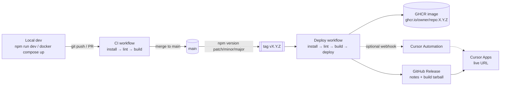

# Deployment & CI/CD

How Grub Roulette goes from a commit on your laptop to a live URL.

## The big picture



| Stage      | Where          | Trigger                           | What happens                                                         |
| ---------- | -------------- | --------------------------------- | -------------------------------------------------------------------- |
| Develop    | your machine   | you                               | `npm run dev` (or `docker compose up`), hot reload on :3337 / :4337  |
| Pre-commit | your machine   | `git commit`                      | Biome checks staged files (`.githooks/pre-commit`)                   |
| CI         | GitHub Actions | every PR, every push to `main`    | install → lint/format check → build                                  |
| Deploy     | GitHub Actions | pushing a `vX.Y.Z` tag            | CI again, then publish image + GitHub Release + optional deploy hook |
| Host       | Cursor Apps    | publish from a Cursor cloud agent | serves the app at its Cursor Apps URL                                |

There is intentionally **no test stage** yet. Add one between lint and build when tests exist.

## The app in production

A single Node 26 process (`npm start` → `apps/api/dist/index.js`):

- serves the API under `/api/*` (Hono)
- serves the built React SPA from `apps/web/dist`, with an `index.html` fallback for client routes
- listens on `$PORT` (the host injects it; Docker defaults to 8080)
- health check: `GET /api/health` → `{ "ok": true, "version": "vX.Y.Z" }`

Build: `npm ci && npm run build`. That typechecks and bundles the web app (Vite 8) and
compiles the API (`tsc`). No source maps are shipped.

## CI workflow (`.github/workflows/ci.yml`)

Runs on every pull request and every push to `main`, and is reused by the deploy workflow.

1. **Install**: `npm ci` with Node from `.nvmrc` (npm cache enabled).
2. **Lint**: `npx biome ci --reporter=github .`, which checks lint rules, formatting, import
   order and Tailwind class order. Problems show up as inline annotations on the PR.
3. **Build**: `npm run build`. TypeScript errors fail here (`tsc -b` for web, `tsc` for API).
4. **Upload artifact**: `apps/web/dist` + `apps/api/dist` as `build` (kept 7 days).

Recommended: in GitHub → Settings → Branches, protect `main` and require the
**"Install, lint, build"** check to pass before merging.

## Deploy workflow (`.github/workflows/deploy.yml`)

Runs when a tag matching `v*.*.*` is pushed.

1. **build**: calls the CI workflow (install → lint → build → upload artifact).
2. **deploy** (GitHub environment `production`):
   1. Fails if the tag doesn't equal `v` + root `package.json` version.
   2. Downloads the `build` artifact (no second build of the JS).
   3. Builds and pushes the Docker image to `ghcr.io/<owner>/<repo>` with tags `X.Y.Z`,
      `X.Y` and `latest`.
   4. Creates a GitHub Release with auto-generated notes and the build tarball attached.
   5. If the `CURSOR_DEPLOY_WEBHOOK_URL` secret exists, POSTs
      `{ version, commit, repository }` to it (see below).

Because the job uses the `production` environment, you can add **required reviewers** in
GitHub → Settings → Environments → production, which gives you a manual approval gate per deploy.

## Cutting a release

```bash
git checkout main && git pull
npm version patch        # or: minor | major
```

- `preversion` runs `npm run check` locally (lint + typecheck + build). If it fails, nothing is tagged.
- `npm version` bumps `package.json`, commits, and creates tag `vX.Y.Z`.
- `postversion` runs `git push --follow-tags`, which starts the Deploy workflow.

Pick the bump with semver: `patch` for fixes, `minor` for features, `major` for breaking changes.

## Hosting on Cursor Apps

Cursor Apps hosting is driven by a Cursor **cloud agent**
([docs](https://cursor.com/docs/cloud-agent/apps.md)). GitHub stays the source of truth.

### First deploy

1. In Cursor, start a cloud agent on this GitHub repo.
2. Prompt: _"Deploy this repo as an app. Read AGENTS.md and docs/deployment.md first."_
3. The agent prepares a preview. Check it, then click **Publish** and choose the URL.
4. Cursor runs security checks (blocks committed secrets, credential files and `.env` files, and
   strips source maps), then gives you a live link.

What the agent needs (all already in the repo): Node `26.13.0` (`.nvmrc`), install `npm ci`,
build `npm run build`, start `npm start`, health `GET /api/health`.

### Subsequent deploys

After the Deploy workflow finishes for a tag, publish that version:

- **Manual (default):** ask a cloud agent _"Redeploy the app at tag vX.Y.Z"_ and Publish.
- **Automated (optional):** create a Cursor **Automation** with a webhook trigger whose prompt
  is _"Redeploy the Grub Roulette app at the version in the webhook payload"_. Put its URL in
  the GitHub secret `CURSOR_DEPLOY_WEBHOOK_URL`. Every tag then kicks off that agent.
  Cursor's docs don't say whether an agent can publish without a person, so expect to approve
  each production deploy yourself.

### Secrets & config

Add secrets in the **Cursor Apps dashboard**, never in the repo:
`GOOGLE_CLIENT_ID`, `GOOGLE_CLIENT_SECRET`, `GOOGLE_MAPS_API_KEY`, `YELP_API_KEY`, and
later model API keys. `/api/config` reports which features are enabled.

### Visibility

Cursor Apps are private (Cursor sign-in) by default. For a public app with Google login,
set visibility to **public** (on Teams/Enterprise an admin may need to allow it).

## Rollback

- **Cursor Apps:** redeploy the previous tag (`"Redeploy the app at tag vX.Y.(Z-1)"`).
- **Any container host:** run the previous image, e.g. `ghcr.io/<owner>/<repo>:0.3.1`.
- Don't delete tags; fix forward with a new patch release.

## Running the production build locally

```bash
npm run build && npm start                       # http://localhost:4337
docker compose --profile prod up --build prod    # http://localhost:8080 (same image as deploy)
```

## One-time GitHub setup checklist

- [ ] Push `main` to GitHub.
- [ ] Settings → Environments → create `production` (optionally add required reviewers).
- [ ] Settings → Branches → protect `main`, require the "Install, lint, build" check.
- [ ] (Optional) Settings → Secrets → Actions → `CURSOR_DEPLOY_WEBHOOK_URL`.
- [ ] After the first Deploy run: Packages → set the GHCR image visibility as desired.

## Troubleshooting

| Symptom                                        | Fix                                                                 |
| ---------------------------------------------- | ------------------------------------------------------------------- |
| CI fails on "Lint and format check"            | Run `npm run lint:fix` locally, commit, push                        |
| Deploy fails "Tag does not match package.json" | Use `npm version …` instead of creating tags by hand                |
| `npm version` refuses to run                   | Working tree must be clean; `preversion` must pass                  |
| Health check shows `"version":"dev"`           | Build ran outside a tag; `APP_VERSION` falls back to `package.json` |
